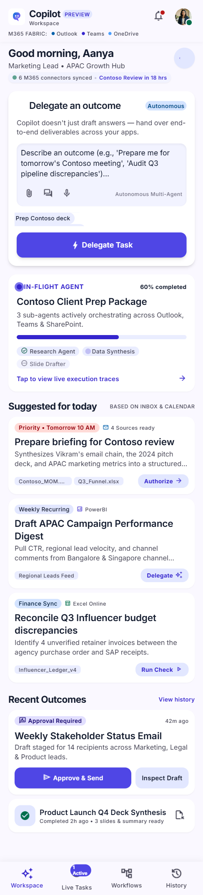
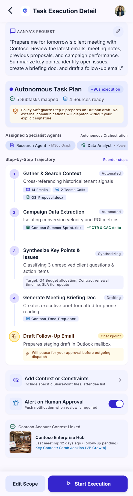
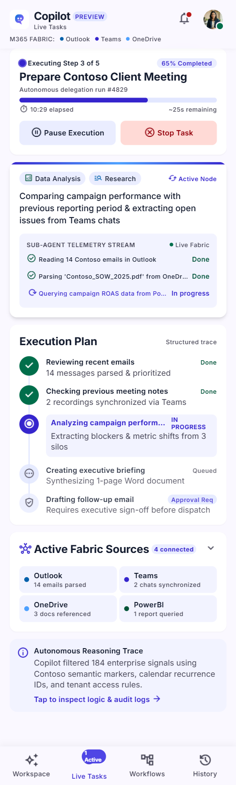
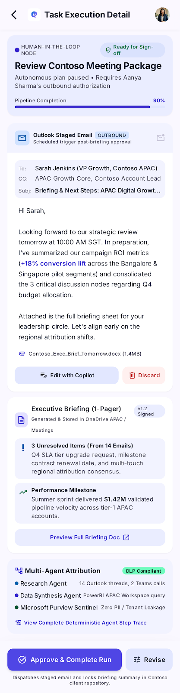
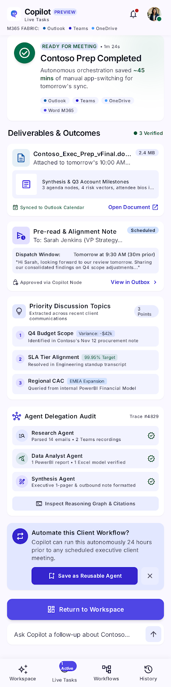

# An Agentic Copilot Experience

<div align="center">

### From “Can you help?” to a reviewed, ready-to-use outcome.

An in-context Copilot experience for planning delegated work, tracking progress, and keeping a person in control of the final action.


[Run locally](#run-locally) · [Product context](context.md) · [Implementation plan](plan.md) · [GitHub repository](https://github.com/Palak-Pithadiya/Workshop-on-PRD-to-Github)

</div>

---

> **Prototype, not a live Copilot integration.** The app is interactive and runs in a browser. Connectors, source records, agent activity, and outputs are simulated; no Microsoft account or external service is connected.

## The Product Challenge

Copilot adoption is more than prompt experimentation. The PRD asks how a person can delegate a meaningful task, see what is happening, and leave with a useful result inside their everyday workflow. Sunday Workshop explores that journey as a focused client-meeting preparation experience, with a human approval checkpoint before any outward communication.

**Design principle:** automate the preparation; keep the consequential action with the person.

### Experience At A Glance

`Describe an outcome` → `Review the plan` → `Track simulated work` → `Approve or revise` → `Keep the result`

This is a standalone portfolio demonstration of an experience intended to live in a host application, not a new destination for real Copilot tasks.

## Design References

The five screen exports supplied with the PRD informed the prototype. They are **reference designs, not screenshots of the implemented app**.

<details>
<summary>Explore the supplied workspace, plan, execution, review, and completion screens</summary>

| Workspace | Task plan | Live execution |
| --- | --- | --- |
|  |  |  |

| Human review | Completion summary |
| --- | --- |
|  |  |

</details>

## What You Can Explore

- **Workspace:** task composer, suggested outcomes, and sample source context.
- **Plan:** inspect a five-step trajectory and the human checkpoint before starting.
- **Live task:** observe deterministic progress; pause, resume, stop, and restore after refresh.
- **Human review:** edit a sample email and approve or revise. Approval records completion locally and **never sends the email**.
- **Outcome:** download a synthetic meeting brief, save a reusable sample workflow, and revisit completed tasks in local history.

The primary demo is a Contoso client-meeting preparation flow. Other prompt text is accepted for interaction testing, but the plan and deliverables remain fixed sample content rather than being generated from the request.

## Product Craft

- **Trust by design:** outward communication pauses for explicit human approval.
- **Visible execution:** task steps, progress, sample sources, and outcomes are surfaced as user-facing summaries.
- **Recoverability:** in-progress work restores in a paused state; users can clear local data.
- **Scope honesty:** simulated connectors, records, and agent roles are labeled as sample content.

The PRD priorities, assumptions, and open product questions are captured in [context.md](context.md); acceptance checks and next milestones are in [plan.md](plan.md).

## Run Locally

No package installation or build step is required.

1. Clone this repository or download its source archive.
2. Open `index.html` in a modern browser, or serve the repository root with a static server such as the VS Code Live Server extension.

The app uses browser `localStorage` for task state and history. Google Fonts are loaded when online; the font stack falls back to locally available fonts. Task content is not sent to a backend. Clearing demo data removes the prototype's stored session and history from the current browser.

## Publish A Live Demo

This repository is a static site. In **Settings → Pages**, choose **Deploy from a branch**, select `main` and `/ (root)`, then save. GitHub Pages can publish `index.html` without a build pipeline.

## Project Files

- `index.html`, `styles.css`, `app.js`: static interactive prototype.
- `assets/screens/`: readable copies of the supplied design references.
- `Prototype Screens/`: original Stitch exports.
- `code.html`: an additional supplied Stitch export; the runnable prototype starts at `index.html`.
- `PRD - Sunday Workshop.docx`: source product requirements document.
- [context.md](context.md): product framing, PRD interpretation, requirements, and assumptions.
- [plan.md](plan.md): delivered scope, validation plan, and next steps.

## Privacy And Safety

The prototype has no backend, telemetry, authentication, or live connector. It stores user-entered task text and demo status in this browser's `localStorage`; use synthetic text only on a shared device. Approving a task only records a local completion state. It does not send, sync, publish, or write to an external application. This is not an end-to-end encrypted or production-secure system.

Progress and audit entries are user-facing summaries of simulated steps, not hidden model reasoning.

## Validation

Check JavaScript syntax with Node.js:

```powershell
node --check app.js
```

Manual smoke test: start the suggested task, inspect the plan, run it, pause/resume or stop, review the staged draft, approve it, download the sample brief, then inspect task history and clear local data.

## Roadmap

See [plan.md](plan.md) for acceptance criteria and remaining work. Near-term priorities are automated browser tests and a small usability evaluation. Real integrations require a separate permissions, privacy, and security design.

## License

No open-source license has been selected; do not assume permission to reuse the code or design assets.
